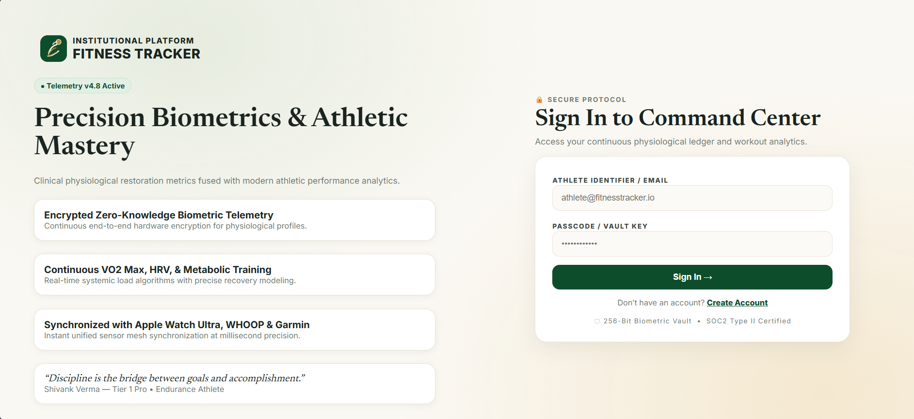

 

 

Hi, I'm Shivank. I'm a computer science student who loves building backend systems with Java and Spring Boot, and I'm always learning something new.

| | |
|---|---|
| **Education** | B.Tech, Computer Science (Data Science), NIET, 2024 – 2028 |
| **GPA** | 8.20 / 10 |
| **Focus** | Java backend development |

**Languages and Web**

**Backend**

**Databases**

**Tools**

**Fundamentals**

### Fitness Tracker &nbsp;

A Java web application for tracking fitness activities and goals, running live in the cloud.

 

<table>
  <tr>
    <td align="center" width="50%">
      
       <b>Login</b>
    </td>
    <td align="center" width="50%">
      
       <b>Activities</b>
    </td>
  </tr>
</table>

Click either screenshot to open the live app.

- User registration and authentication
- Fitness activity tracking and goal management
- Dashboard
- Cloud database integration
- Dockerized deployment

**Built with:** Java 21, Spring Boot, Spring Security, Thymeleaf, MySQL-compatible TiDB, Spring Data JPA, Hibernate, Docker, Docker Compose, Render

 

### Bharat Bhumi &nbsp;

A digital land records and unified land administration platform.

- Citizen-facing land services
- Property records and ownership workflows
- Document management
- GIS exploration and land discovery
- Administrative review workflows

**Built with:** Java, Spring Boot, PostgreSQL, JTS (spatial data)

 

### Veleon &nbsp;

A software engineering workspace.

- Project and task management
- Authentication and role-based access control
- API documentation
- Planned: real-time collaboration with WebSockets
- Planned: GitHub integration and health monitoring

**Built with:** Java, Spring Boot, Spring Security, PostgreSQL, JPA/Hibernate, JWT

- Real-time features with WebSockets
- GitHub integration and application health monitoring
- Containerized deployment with Docker and Docker Compose
- Data structures and algorithms

