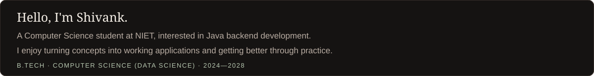
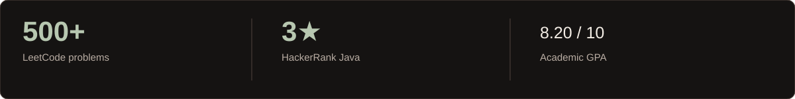
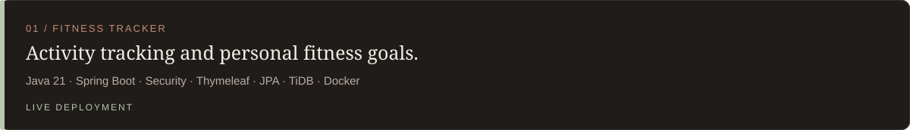
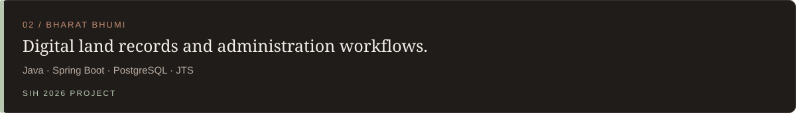
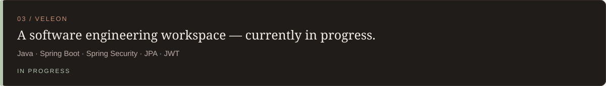
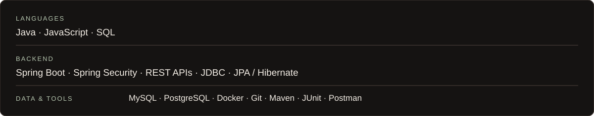

[LinkedIn](https://linkedin.com/in/shivankkk) · [GitHub](https://github.com/shivankydv) · [Email](mailto:shivankydv14@gmail.com)

[Live demo](https://fitness-tracker-nyp5.onrender.com/) · [Source code](https://github.com/shivankydv/Fitness_Tracker)

