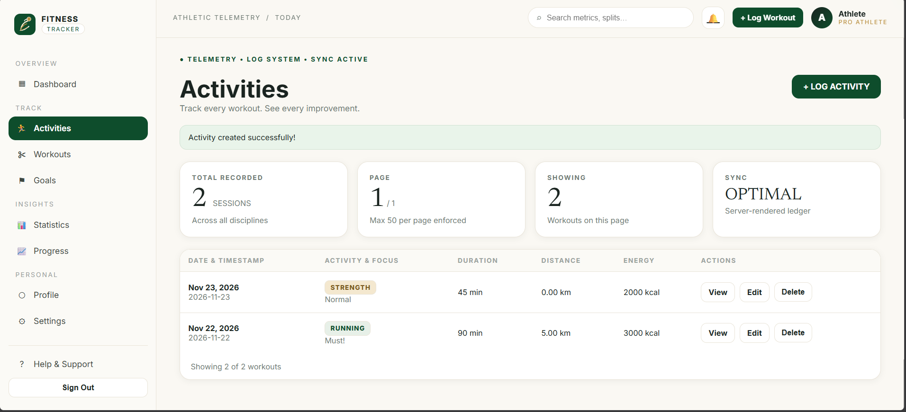

Hi, I'm Shivank. I'm a computer science student who likes building backend systems with Java and Spring Boot, and I'm always working on getting better at it.

---

### About

| | |
|---|---|
| **Education** | B.Tech, Computer Science (Data Science), NIET, 2024 – 2028 |
| **GPA** | 8.20 / 10 |
| **Focus** | Java backend development |
| **Problem solving** | 500+ LeetCode problems solved · 3-star Java on HackerRank |

---

### Skills

| | |
|---|---|
| **Languages** |     |
| **Backend** |      |
| **Databases** |   |
| **Tools** |      |
| **Fundamentals** | Object-Oriented Programming · Data Structures & Algorithms |

---

### Projects

#### Fitness Tracker

A Java web application for tracking fitness activities and goals. Completed and deployed.

<table>
  <tr>
    <td width="50%" align="center">
      
    </td>
    <td width="50%" align="center">
      
    </td>
  </tr>
</table>

Click either screenshot to open the live app.

- User registration and authentication
- Fitness activity tracking and goal management
- Dashboard
- Cloud database integration
- Dockerized deployment

**Built with:** Java 21, Spring Boot, Spring Security, Thymeleaf, MySQL-compatible TiDB, Spring Data JPA, Hibernate, Docker, Docker Compose, Render

 

#### Bharat Bhumi

A digital land records and unified land administration platform, built for Smart India Hackathon 2026.

- Citizen-facing land services
- Property records and ownership workflows
- Document management
- GIS exploration and land discovery
- Administrative review workflows

**Built with:** Java, Spring Boot, PostgreSQL, JTS (spatial data)

 

#### Veleon

A software engineering workspace. Currently in progress.

- Project and task management
- Authentication and role-based access control
- API documentation
- Planned: real-time collaboration with WebSockets
- Planned: GitHub integration and health monitoring

**Built with:** Java, Spring Boot, Spring Security, PostgreSQL, JPA/Hibernate, JWT

---

### GitHub

  
  

---

### Currently exploring

- Real-time features with WebSockets
- GitHub integration and application health monitoring
- Containerized deployment with Docker and Docker Compose
- Data structures and algorithms

---

### Get in touch

[LinkedIn](https://linkedin.com/in/shivankkk) · [Email](mailto:shivankydv14@gmail.com) · [GitHub](https://github.com/shivankydv)
